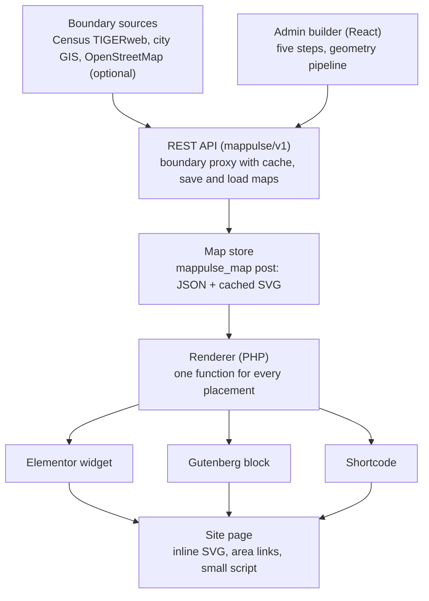

# MapPulse

Clickable, branded market maps for real estate websites, generated from real boundary data.

MapPulse is a WordPress plugin in development. It builds an interactive map of the areas an agent or
brokerage serves, where every neighborhood, city or ZIP area links to its area page or property search.
The map is placed with an Elementor widget, a Gutenberg block or a shortcode.

> **Status: Phase 0 (spike).** The WordPress plugin is not in this repository yet, and nothing here
> can be installed in WordPress. The repository currently holds the spike that proves the map output
> on real data, plus the development plan.

## Why

Most "service area" maps on real estate sites are either a generic map embed or a hand-drawn graphic
that costs design hours for every client. Maps assembled from a few selected shapes also tend to float
on an empty page, with gaps between areas and nothing to show where they are.

MapPulse aims for the middle: maps generated from official boundary data, drawn as a complete
picture (land, coastline, water, surrounding areas, major roads), then styled and decorated to match
the site's brand.

## Planned for version 1.0

- Add neighborhoods, cities, ZIP areas and counties from real boundary sources, each confirmed on a
  live street map before it is saved.
- Mix region types on one map with no overlaps and no slivers.
- Fill the space between zones with land, coastline, water, muted surrounding areas and major roads.
- Take colors and fonts from the site, with three style presets (Atlas, Brand Tint, Minimal Line).
- Decorate with an icon library, text labels, a compass and a legend.
- Link each zone to an area page, an IDX search or any URL, with an optional hover card.
- Work on phones and by keyboard, and output a crawlable list of area links.
- Import a hand-drawn SVG and bind its layers to zones.

Not in 1.0: live listing data in hover cards, listing pins or property search on the map, markets
outside the United States, and a live-tile map preset.

## How it will work



- The front end is inline SVG. It needs no map library and no API key, and makes no third-party request.
- Boundary sources are reached only from the WordPress admin. Confirmed shapes are stored in WordPress.
- The Elementor widget, the block and the shortcode are thin wrappers over one renderer.

## Repository layout

| Path | Holds |
| --- | --- |
| `spike/` | Phase 0 spike: Node scripts that download real boundary layers and render one full-context SVG |
| `spike/results/` | Output of the latest spike run on GitHub Actions: the SVG, a preview page, reports and logs |
| `docs/development-plan.md` | Scope, architecture, data model, integrations, phases and testing |
| `docs/data-sources.md` | Boundary sources, how exact each one is, usage limits and attribution |
| `.github/workflows/spike.yml` | Runs the spike on every push that touches it |

The plugin source will be added in Phase 1.

## Phase 0 spike

The spike rebuilds one real market map (St. Petersburg, Florida) from public sources to prove the
look and measure file size before any plugin code is written.

Run it locally (Node 18 or later, with internet access):

```
cd spike
npm install
npm run fetch
npm run build
```

Then open `spike/out/preview.html`.

Or let GitHub run it: every push that changes `spike/` starts the **Spike** workflow. It first runs the
pipeline on stand-in data as a smoke test, then downloads the real layers, builds the map, and commits
the result to `spike/results/st-petersburg/`:

| File | What it is |
| --- | --- |
| `st-petersburg.svg` | The rendered map |
| `preview.html` | The map with its zone list (download and open it in a browser) |
| `report.json` | Zones matched, names available in each source, notes and warnings |
| `sources.json` | Which service and layer each download used |
| `fetch.log`, `build.log` | Console output of the run |

See [`spike/README.md`](spike/README.md) for the configuration file and what the spike leaves out.

## Roadmap

| Phase | Delivers | Exit check |
| --- | --- | --- |
| 0 Spike | One real market rebuilt by script as a full-context SVG | No gaps, no overlaps, look approved |
| 1 Core build | Plugin skeleton, map storage, renderer, shortcode, Elementor widget, Gutenberg block, builder steps for areas, base map, style, zones and links | A map made in the builder is live through all three placements |
| 2 Decorate | Icon library, labels, compass, legend, clickable landmarks, SVG import | A decorated generated map and an imported hand-drawn map both render correctly |
| 3 Polish | Phone pan and zoom, bottom sheet, keyboard access, crawlable list, performance budgets, compatibility matrix | Budgets met and the matrix passes |
| 4 Release | Migration of existing maps, user guide, packaging, version 1.0.0 | 1.0 running on production sites |

## Data sources

| Region type | Source | How exact |
| --- | --- | --- |
| County, city | US Census TIGERweb | Legal boundary as of the layer's vintage |
| ZIP area | Census ZIP Code Tabulation Areas | Approximate; not every ZIP has one |
| Neighborhood | City or county GIS layer where one is published | Official where published |
| Neighborhood, fallback | OpenStreetMap, then draw or upload | Community-mapped or hand-made |

Details, usage limits and attribution rules are in [`docs/data-sources.md`](docs/data-sources.md).

## Planned requirements

These are proposals until Phase 1 fixes them.

- WordPress 6.8 or later
- PHP 8.1 or later
- Elementor is optional: the block and the shortcode work without it

## License

No license has been chosen yet. Until a license file is added, all rights are reserved.

## Credits

Built by [Agent View Digital](https://agentviewdigital.com), a real estate website agency.
