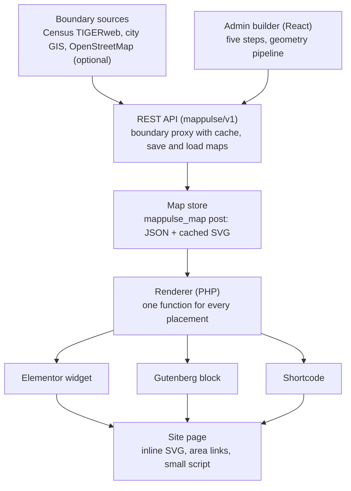

# MapPulse

Clickable, branded market maps for real estate websites, generated from real boundary data.

MapPulse is a WordPress plugin in development. It shows the areas an agent or brokerage serves as one
interactive map, where every neighborhood, city or ZIP area links to its area page or property search.
The map is placed with an Elementor widget, a Gutenberg block or a shortcode.

> **Status: version 0.2.0, early release.** The plugin installs, renders maps through all three
> placements, and finds real boundaries from inside WordPress. Maps are still added from a map file:
> the visual map builder is the next version. A real sample map of St. Petersburg, Florida is included.

## Install and try it

1. Download `mappulse.zip` from the [Releases](https://github.com/ferozsaha100/MapPulse/releases) page.
   Before the first release, take it from the `mappulse-plugin` artifact of the latest
   [Plugin workflow run](https://github.com/ferozsaha100/MapPulse/actions/workflows/plugin.yml).
2. In WordPress go to Plugins, Add New, Upload Plugin. Upload the zip and activate MapPulse.
3. Go to MapPulse, Import, and choose **Import the sample map**.
4. Place the map on a page, in any of three ways:

| Placement | How |
| --- | --- |
| Elementor | Drag the **MapPulse Map** widget onto the page and pick the map. Colors and maximum height are on the Style tab. |
| Block editor | Insert the **MapPulse Map** block and pick the map. Layout, heading and intro are in the block sidebar. |
| Shortcode | `[mappulse id="12" layout="list-left" heading="Explore the area"]` |

Layouts are `list-left`, `list-right`, `list-below` and `map-only`. The shortcode also takes
`intro="..."` and `list="no"`.

### Styling

Every color is a CSS custom property. Each map carries its own defaults, and any of them can be
overridden on the map or on a parent element:

```css
.mappulse {
	--mappulse-zone: #e6dccb;
	--mappulse-zone-hover: #7a1f1f;
	--mappulse-label: #2b2f36;
}
```

Available: `--mappulse-zone`, `--mappulse-zone-stroke`, `--mappulse-zone-hover`, `--mappulse-label`,
`--mappulse-label-hover`, `--mappulse-water`, `--mappulse-coast`, `--mappulse-land`,
`--mappulse-context`, `--mappulse-context-stroke`, `--mappulse-road`, `--mappulse-road-casing`,
`--mappulse-water-label`, `--mappulse-font` and `--mappulse-max-height`.

### Linking areas

Each zone in a map file has a `link` field. The sample map ships with empty links, so its areas
highlight but do not go anywhere. To link an area, set its link in the `.map.json` file and import the
file again:

```json
{ "id": "downtown", "name": "Downtown", "link": "/neighborhoods/downtown/" }
```

The map builder will replace this step.

### Finding boundaries

**MapPulse, Sources** finds the real boundary of an area and draws its outline so you can confirm it.

- Cities, ZIP areas and counties anywhere in the US come from the US Census Bureau. Type a name or a
  ZIP code, and narrow by state if needed.
- Neighborhoods come from map layers that cities publish. Under "Add a neighborhood layer", paste the
  address of the city's ArcGIS layer once; its neighborhoods are then found by name. The St. Petersburg
  layer is shown there as an example.
- Each result has a "Show boundary" button and a link to check the same area on a street map.

Your site contacts only the Census server and the layers you register, only from the admin, and saves
each answer for 30 days. The same search is available as `wp mappulse find gulfport --state=FL`.

### Known limits

- There is no map builder yet. Maps come from a map file made by the script in `spike/`.
- On a phone the map scales down with the screen, so the labels of a detailed map are too small to read.
  The area list stays readable and usable. Pan and zoom are planned for the Polish phase.
- Hover cards, decoration, a compass and a legend are not built yet.
- Found boundaries cannot be turned into a map inside WordPress yet. That is the builder, version 0.3.0.
- This version is for testing. It is not meant for a live client site yet.

### From the command line

```
wp mappulse import --sample
wp mappulse import ./my-market.map.json --title="My market"
```

## Why

Most "service area" maps on real estate sites are either a generic map embed or a hand-drawn graphic
that costs design hours for every client. Maps assembled from a few selected shapes also tend to float
on an empty page, with gaps between areas and nothing to show where they are.

MapPulse aims for the middle: maps generated from official boundary data, drawn as a complete
picture (land, coastline, water, surrounding areas, major roads), then styled and decorated to match
the site's brand.

## Planned for version 1.0

- Add neighborhoods, cities, ZIP areas and counties from real boundary sources, each confirmed on a
  live street map before it is saved.
- Mix region types on one map with no overlaps and no slivers.
- Fill the space between zones with land, coastline, water, muted surrounding areas and major roads.
- Take colors and fonts from the site, with three style presets (Atlas, Brand Tint, Minimal Line).
- Decorate with an icon library, text labels, a compass and a legend.
- Link each zone to an area page, an IDX search or any URL, with an optional hover card.
- Work on phones and by keyboard, and output a crawlable list of area links.
- Import a hand-drawn SVG and bind its layers to zones.

Not in 1.0: live listing data in hover cards, listing pins or property search on the map, markets
outside the United States, and a live-tile map preset.

## How it will work



- The front end is inline SVG. It needs no map library and no API key, and makes no third-party request.
- Boundary sources are reached only from the WordPress admin. Confirmed shapes are stored in WordPress.
- The Elementor widget, the block and the shortcode are thin wrappers over one renderer.

## Repository layout

| Path | Holds |
| --- | --- |
| `mappulse/` | The WordPress plugin: map storage, renderer, Elementor widget, Gutenberg block, shortcode, import |
| `mappulse/tests/` | PHPUnit tests and the end-to-end smoke script |
| `bin/build-zip.sh` | Builds the installable `mappulse.zip` |
| `spike/` | Node scripts that download real boundary layers, render one full-context SVG and export the map file the plugin imports |
| `spike/results/` | Output of the latest spike run on GitHub Actions: the SVG, a preview page, reports and logs |
| `docs/development-plan.md` | Scope, architecture, data model, integrations, phases and testing |
| `docs/data-sources.md` | Boundary sources, how exact each one is, usage limits and attribution |
| `docs/superpowers/plans/` | Task-level implementation plans, one per stage |
| `.github/workflows/plugin.yml` | Syntax check, coding standards, PHPUnit in WordPress, end-to-end smoke test, zip build |
| `.github/workflows/release.yml` | Publishes a release with the zip when a `v*` tag is pushed |
| `.github/workflows/spike.yml` | Runs the spike on every push that touches it |

## Development

The plugin is tested inside a real WordPress with [`@wordpress/env`](https://www.npmjs.com/package/@wordpress/env)
(needs Docker), with Elementor installed alongside it.

```
npm install
cd mappulse && composer install && cd ..
npx wp-env start
npm run test:php                 # PHPUnit inside WordPress
bash mappulse/tests/smoke.sh     # end-to-end: import, three placements, Elementor on and off, uninstall
cd mappulse && composer lint     # WordPress coding standards
bash bin/build-zip.sh            # builds mappulse.zip
```

The smoke script ends by uninstalling the plugin from the test site, so run it last.

## Phase 0 spike

The spike rebuilds one real market map (St. Petersburg, Florida) from public sources to prove the
look and measure file size before any plugin code is written.

Run it locally (Node 18 or later, with internet access):

```
cd spike
npm install
npm run fetch
npm run build
```

Then open `spike/out/preview.html`.

Or let GitHub run it: every push that changes `spike/` starts the **Spike** workflow. It first runs the
pipeline on stand-in data as a smoke test, then downloads the real layers, builds the map, and commits
the result to `spike/results/st-petersburg/`:

| File | What it is |
| --- | --- |
| `st-petersburg.svg` | The rendered map |
| `preview.html` | The map with its zone list (download and open it in a browser) |
| `report.json` | Zones matched, names available in each source, notes and warnings |
| `sources.json` | Which service and layer each download used |
| `fetch.log`, `build.log` | Console output of the run |

See [`spike/README.md`](spike/README.md) for the configuration file and what the spike leaves out.

## Roadmap

| Phase | Delivers | Exit check |
| --- | --- | --- |
| 0 Spike | One real market rebuilt by script as a full-context SVG | No gaps, no overlaps, look approved |
| 1 Core build | Plugin skeleton, map storage, renderer, shortcode, Elementor widget, Gutenberg block (0.1.0) and the boundary service (0.2.0) are done. Next: the builder steps for areas, base map, style, zones and links (0.3.0) | A map made in the builder is live through all three placements |
| 2 Decorate | Icon library, labels, compass, legend, clickable landmarks, SVG import | A decorated generated map and an imported hand-drawn map both render correctly |
| 3 Polish | Phone pan and zoom, bottom sheet, keyboard access, crawlable list, performance budgets, compatibility matrix | Budgets met and the matrix passes |
| 4 Release | Migration of existing maps, user guide, packaging, version 1.0.0 | 1.0 running on production sites |

## Data sources

| Region type | Source | How exact |
| --- | --- | --- |
| County, city | US Census TIGERweb | Legal boundary as of the layer's vintage |
| ZIP area | Census ZIP Code Tabulation Areas | Approximate; not every ZIP has one |
| Neighborhood | City or county GIS layer where one is published | Official where published |
| Neighborhood, fallback | OpenStreetMap, then draw or upload | Community-mapped or hand-made |

Details, usage limits and attribution rules are in [`docs/data-sources.md`](docs/data-sources.md).

## Requirements

- WordPress 6.8 or later
- PHP 8.1 or later
- Elementor is optional: the block and the shortcode work without it

Version 0.1.0 was tested on WordPress 6.8 and 7.1 and with Elementor 4.4, with atomic elements off and on.

## License

The plugin header declares GPL-2.0-or-later, the license WordPress itself uses. A `LICENSE` file will be
added once the owner confirms that choice.

## Credits

Built by [Agent View Digital](https://agentviewdigital.com), a real estate website agency.
