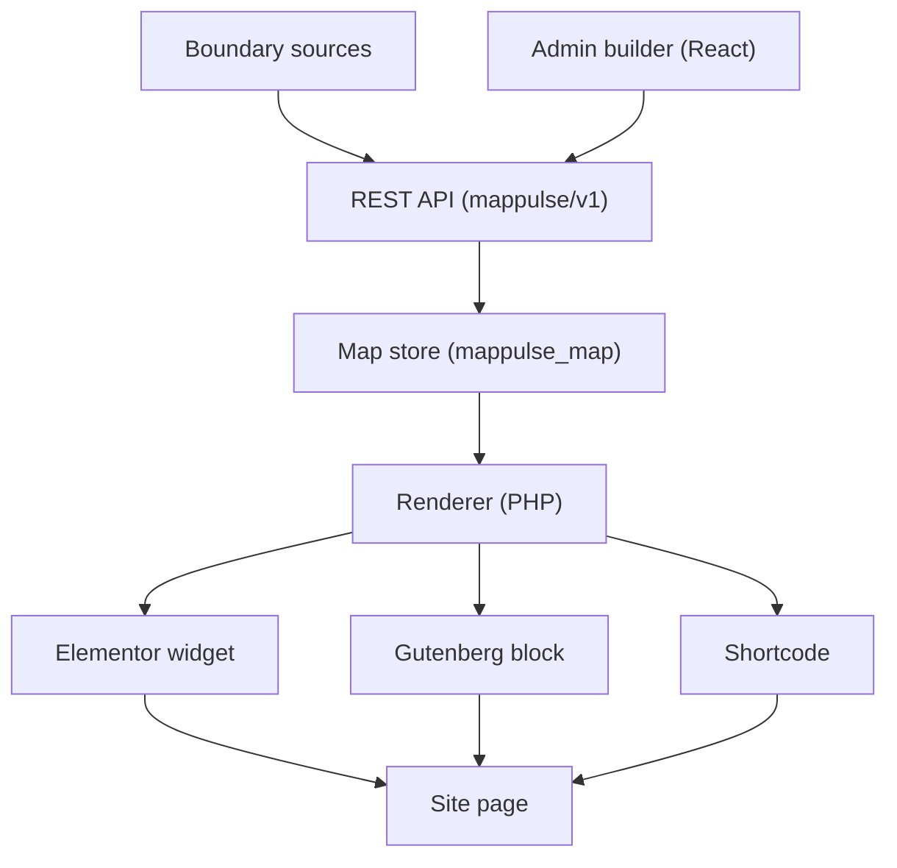

# MapPulse development plan

MapPulse is a WordPress plugin that builds a branded, clickable market map for a real estate site
from real boundary data, with no designer drawing it.

- **Who builds maps:** the site's developer or agency, in WP admin.
- **What it outputs:** inline SVG, placed by an Elementor widget, a Gutenberg block or a shortcode.
  All three call one renderer.

## 1. Scope

Version 1.0 must:

1. Add neighborhoods, cities, ZIP areas and counties from real boundary data, each confirmed on a live street map.
2. Mix those region types on one map with no overlaps and no slivers.
3. Fill the space between zones with land, coastline, water, muted surrounding areas and major roads.
4. Take colors and fonts from the site, with three style presets.
5. Decorate with an icon library, text labels, a compass and a legend.
6. Link each zone to an area page, an IDX search or any URL, with an optional hover card.
7. Work on phones and by keyboard, and output a crawlable list of area links.
8. Import a hand-drawn SVG and bind its layers to zones.

Not in version 1.0:

- Live listing numbers in hover cards. Card stats are typed in.
- Listing pins or property search on the map.
- Markets outside the United States. The boundary sources in this plan are US sources.
- The Live Map preset (zones over Google or Leaflet tiles on the front end). Planned for 1.1.

## 2. Decisions

| Decision | Call | Why |
| --- | --- | --- |
| Delivery | A self-contained WordPress plugin | The front end is static SVG and gains nothing from being hosted. A hosted data service can be added later behind the provider interface. |
| Artwork model | Generated base map, plus a decoration layer, plus optional SVG import | The generated base needs no design hours; import covers fully bespoke art. |
| Front-end output | Inline SVG. No map library and no API key. | Fast, styleable with CSS, and no third-party request on the site. |
| Live tiles | In the admin only (Leaflet), to confirm a boundary against real streets | Accuracy check without a front-end dependency. |
| Geometry processing | In the browser, inside the builder. PHP only stores and renders. | Mature JavaScript libraries exist for clipping, snapping and simplifying. |
| Placements | Elementor widget, Gutenberg block and shortcode as thin wrappers over one PHP renderer | One output to test. A fix lands in all three at once. |
| Builder UI | React through `@wordpress/scripts`, using WordPress's bundled React | Shares its build and components with the block. |

## 3. Features

| Area | In version 1.0 | After 1.0 |
| --- | --- | --- |
| Areas | Search by type inside a chosen city or county. Every result shows its source. Preview on a live street map, then confirm. Draw a zone by hand. Upload GeoJSON or KML. Edit points. Reorder zones. | Non-US sources |
| Base map | Land and real coastline, water with names, surrounding areas drawn muted, major roads. Gap modes: zones only, land and water, full context. Fit to city boundary, to the zones, or to a custom frame. | Inset map for a far-away zone. Parks. |
| Style | Presets: Atlas, Brand Tint, Minimal Line. Colors and fonts read from the site. Label font and size. Hover effect and color. Border width and line style. | Live Map preset |
| Decorate | Icon library, custom SVG icons, text labels, compass, a legend built from the icons in use. Clickable landmarks with hover text. Layers panel. | More icon sets |
| Zones and links | Label text and position. Link to an area page, an IDX search URL or a custom URL. Auto-match zones to existing pages by name. Hover card with image, tagline, two stat rows and two buttons. | Live listing numbers in the card |
| Publish | Elementor widget, Gutenberg block, shortcode. Layouts: map with area list, map only, full width. Phone behavior setting. | Analytics on zone clicks |
| Import | Upload an SVG drawn in Illustrator or Figma. Detect layers named `zone-` and `poi-`. Match layers to zones. Unmatched layers stay as artwork. | Designer templates |

## 4. Architecture

The plugin has one data path: the builder saves a map document, the renderer turns it into SVG, and
three thin placements put that SVG on a page.



| Component | Responsibility | Runs in |
| --- | --- | --- |
| Admin builder | The five-step editor, artwork import and the geometry pipeline | Browser, WP admin |
| REST API | Map storage routes, boundary proxy with cache and throttle, link search, preview render | PHP |
| Boundary providers | One class per source behind a shared interface: Census, registered GIS layer, OpenStreetMap, file upload | PHP |
| Map store | The `mappulse_map` post type, document schema, migrations, export and import | PHP |
| Renderer | Map document to section HTML and cached SVG | PHP |
| Placements | Elementor widget, Gutenberg block, shortcode | PHP, plus the block's editor script |
| Front-end script | Hover cards, list sync, phone pan and zoom, bottom sheet | Browser, public site |

Planned plugin layout:

```
mappulse/
  mappulse.php                    plugin header and bootstrap
  includes/
    class-plugin.php              hooks, capability, asset registration
    class-map-post-type.php       mappulse_map post type and meta
    class-map-document.php        schema, validation, migrations
    class-renderer.php            mappulse_render_map() and the SVG cache
    class-rest-controller.php     mappulse/v1 routes
    class-svg-sanitizer.php       upload filtering
    class-shortcode.php
    providers/                    census, arcgis, osm, upload
    integrations/                 elementor loader and widget
  blocks/mappulse/                block.json, edit.js, render.php
  src/
    builder/                      React app, one folder per step
    pipeline/                     overlap, snap, clip, simplify, project, labels
    frontend/                     view script and stylesheet
  assets/icons/                   icon library
  tests/                          php, js, fixtures
```

## 5. Data model

Each map is one private post of type `mappulse_map` holding a single versioned JSON document, plus a
cached copy of its rendered SVG.

| Stored as | Key | Holds |
| --- | --- | --- |
| Post | `mappulse_map` | Map name, draft or published status, revisions |
| Post meta | `_mappulse_map` | The map document (JSON, `schema: 1`) |
| Post meta | `_mappulse_svg` | Rendered SVG, rebuilt on every save |
| Post meta | `_mappulse_hash` | Hash of the document the SVG was built from |

| Document section | Holds |
| --- | --- |
| `frame` | Aspect ratio, margin, extent mode, projection settings |
| `zones[]` | id, name, type, priority, source record, source geometry (GeoJSON), label, link, hover card, style overrides |
| `base` | Land, water bodies, surrounding areas and roads, each with source and geometry |
| `style` | Preset, colors, fonts, borders, hover effect |
| `decor[]` | Icon or custom SVG reference, position, size, rotation, link, hover text, layer |
| `artwork` | Optional imported SVG and its layer-to-zone bindings |
| `topology` | Derived shapes used for drawing: overlaps resolved, borders snapped, clipped, simplified |

Source geometry is never altered. Drawing always uses the derived `topology`, which can be rebuilt at
any time. A map exports to and imports from one JSON file.

## 6. Boundary pipeline

Sources, limits and attribution are in [data-sources.md](data-sources.md).

Region types overlap by nature: a ZIP area contains neighborhoods, and a city contains both. A priority
order resolves it.

- Default priority is neighborhood, then city, then ZIP area, then county. It can be reordered per map.
- A higher-priority zone is cut out of any lower one beneath it.
- A zone can instead be marked as a backdrop: kept whole and drawn underneath.
- The builder warns when cutting leaves a zone in pieces or very small.

Pipeline:

1. Search a source. Results list the type, the parent place and the source.
2. Preview the shape over live street tiles. The user confirms or rejects it.
3. Store the source geometry and its source record.
4. Clean the outline where asked: close gaps up to 60 m and fill holes, so a place the source draws in
   pieces becomes one solid shape. On by default only for shapes in pieces or with holes.
5. Resolve overlaps by priority.
6. Snap shared borders so neighbors keep one common edge.
7. Clip every zone to the coastline.
8. Simplify the whole map at one tolerance, keeping shared edges shared.
9. Project all layers with one projection fitted to the map frame.
10. Place each label inside its zone, then resolve collisions.
11. Write the SVG paths and save.

Since 0.3.0 the builder runs every step except 6 in the browser (`mappulse/src/geometry`). Step 6,
snapping, is not built yet. The Phase 0 spike in `spike/` is the script this library was ported from.

## 7. Front-end renderer

One PHP function, `mappulse_render_map( $map_id, $args )`, returns the whole section: optional heading
and intro, the area list, the inline SVG and the hover-card markup.

- SVG groups sit in draw order: land, surrounding areas, zones, water, roads, decoration, labels, then compass and legend.
- Each zone is an SVG link around its shape. Clicks work with JavaScript off, zones take keyboard focus, and crawlers see real links.
- The area list is plain HTML links, synced with the map on hover and focus.
- Colors and sizes are CSS custom properties (`--mappulse-*`), so each placement can override them.

| Input | Result |
| --- | --- |
| Hover or keyboard focus on a zone or list item | The zone takes the hover color and its card opens |
| Click, or Enter on a focused zone | Goes to the zone's link |
| Tap on a phone | Opens a bottom sheet with the card. Its button follows the link. |
| Drag or pinch on a phone | Pans and zooms the map inside its frame |

Budgets (targets, validated by the spike):

| Item | Target |
| --- | --- |
| SVG for a 30-zone decorated map | 250 KB or less before compression |
| Script | 15 KB or less, gzipped |
| Stylesheet | 5 KB or less, gzipped |
| Layout shift caused by the map | None |

## 8. Elementor integration

- A classic widget extending `\Elementor\Widget_Base`, registered on `elementor/widgets/register`.
- Loaded only when Elementor is active.
- Content controls: map picker, layout, heading, intro, area list, hover cards, phone behavior.
- Style controls: typography, list colors, hover color, card radius and shadow, maximum map height.
- `render()` calls `mappulse_render_map()`, so the editor preview is the real server output.
- Scripts and styles are declared through `get_script_depends()` and `get_style_depends()`.
- Elementor 4: the classic widget works beside atomic elements. All CSS targets the plugin's own
  classes, and every release is tested with atomic features off and on.

## 9. Gutenberg block and shortcode

- Block `agentview/mappulse`, `block.json` with `apiVersion: 3`, rendered on the server through the `render` property.
- Attributes: `mapId`, `layout`, `heading`, `intro`, `showList`, `showCards`, `phoneMode`.
- Supports wide and full alignment, spacing and an HTML anchor.
- Front-end assets are declared in `block.json`, so they load only where the block appears.
- Shortcode: `[mappulse id="12" layout="list-left"]`, for classic themes and other page builders.

## 10. Admin builder

A full-screen React app in WP admin with five steps: Areas, Style, Decorate, Zones and links, Publish.
An import screen handles hand-drawn artwork.

| Route (`mappulse/v1`) | Purpose |
| --- | --- |
| `/maps`, `/maps/<id>` | List, read, create, update and delete maps |
| `/boundaries/search` | Proxy to boundary sources: throttled, cached, limited to allowed hosts |
| `/boundaries/fetch` | Fetch one shape by source and record ID |
| `/links/search` | Find pages and posts for zone links and auto-match |
| `/render/<id>` | Preview render for the builder and the block |

One capability, `manage_mappulse_maps`, guards every builder route.

## 11. Security

| Surface | Control |
| --- | --- |
| SVG upload | Capability check, then an allowlist sanitizer strips scripts, event handlers, external references and embedded HTML. A file that fails is rejected. |
| REST API | Permission callback and nonce on every route. Input is validated against the document schema. |
| Output | All attributes and URLs are escaped. Hover-card fields are plain text. |
| Remote requests | `wp_safe_remote_get` with timeouts, limited to the configured source hosts. |
| Visitor privacy | No visitor data is collected. SVG presets make no third-party request on the front end. |

## 12. Phases

| Phase | Delivers | Exit check |
| --- | --- | --- |
| 0 Spike | One real market rebuilt by script as a full-context SVG. Measured file size and label legibility. | No gaps and no overlaps, and the look is approved |
| 1 Core build | Plugin skeleton, map post type and schema, REST API, renderer, shortcode, Elementor widget, Gutenberg block. Builder steps: Areas, base map, Style, Zones and links. | A map made in the builder is live through all three placements |
| 2 Decorate | Icon library, text labels, compass, legend, clickable landmarks, layers. Minimal Line preset. SVG import with the sanitizer. | A decorated generated map and an imported hand-drawn map both render correctly |
| 3 Polish | Phone pan and zoom, bottom sheet, area chips, keyboard access, crawlable list, budgets, the compatibility matrix | Budgets met and the matrix passes |
| 4 Release | Existing maps migrated. User guide. Packaging. Version 1.0.0. | 1.0 running on production sites |

Each phase gets its own task-level plan, written at its start against this repository. Phase 1 is
delivered in four releases: 0.1.0 (plugin foundation), 0.2.x (boundary service), 0.3.0 (builder: Areas
and base map) and 0.4.0 (builder: Style, and Zones and links).

## 13. Testing

| Fixture map | Proves |
| --- | --- |
| St. Petersburg: neighborhoods, ZIP areas and a city | Mixed types, scattered zones, coastline |
| Contiguous inland city | Shared borders with no water |
| Coast with islands | Clipping and zones in several parts |
| Rural county with few zones | Large empty areas and sparse labels |
| Imported SVG artwork | Layer detection, sanitizing, bindings |

| Test type | Covers | Tool |
| --- | --- | --- |
| Unit, JavaScript | Overlap cutting, snapping, clipping, simplification, label placement | `wp-scripts test-unit-js` |
| Unit, PHP | Renderer output, schema validation and migration, REST permissions, SVG sanitizer | PHPUnit |
| Snapshot | Rendered SVG of each fixture against a stored copy | PHPUnit |
| Lint | PHP and JavaScript standards | PHPCS, ESLint |

Checks before every release: no overlapping zones, no gap wider than the snap tolerance, every label
inside its zone, every zone linked or flagged, a full keyboard pass, and the budgets met.

## 14. Risks

| Risk | Mitigation |
| --- | --- |
| Neighborhood data is missing or poor in a market | Per-market source registry, the source shown on every result, draw and upload as the fallback |
| Mixed region types overlap | Priority cutting, the backdrop option, warnings, a mixed-type fixture in every test run |
| Public geocoder limits | Census queried by name first. OpenStreetMap search is optional, throttled and cached. |
| Elementor moves to atomic elements | Classic widget now, no wrapper-dependent CSS, both modes tested each release |
| Large markets produce heavy SVG | One simplification tolerance per map, coordinate rounding, a size warning at save |
| Labels collide in small zones | Automatic placement, manual move, then a smaller label or a number with a legend entry |
| An uploaded SVG carries script | Sanitizer, capability limit, rejection on failure |

## 15. Open technical decisions

- Minimum versions. Proposal: WordPress 6.8, PHP 8.1, the final Elementor 3.x release and all of 4.x.
- Whether the Live Map preset moves into 1.0.
- Which non-US boundary sources to add first.
